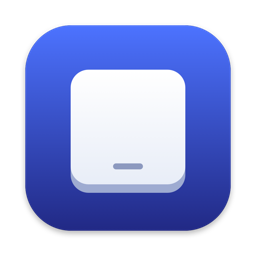
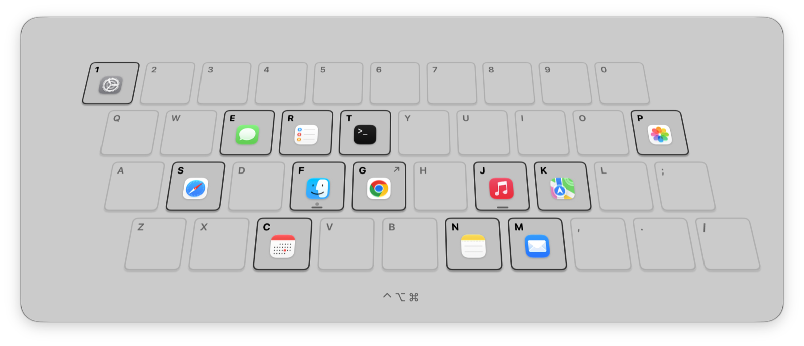

# Deft

Hold a modifier combo, see your keyboard as an app launcher, press a key.

<picture>
  <source media="(prefers-color-scheme: dark)" srcset="docs/overlay-dark.png">
  
</picture>

- **⌃⌥⌘ + key** launches the app on that key, focuses it if it's running, hides it if it's already in front.
- **Hold ⌃⌥⌘** for a moment and the overlay shows every mapping. It stays up until you let go, so you can launch several apps in a row.
- Keys can also open a URL or folder, or run a shell command.
- Physical keys, labelled for your layout (QWERTY, AZERTY, …). Works with Hyper keys and Karabiner.
- Native Swift, one event tap, no polling. Focusing a running app takes ~30 ms.

## Install

```sh
brew install --cask hugo-clemente/tap/deft
```

Or download `Deft.zip` from [Releases](https://github.com/hugo-clemente/deft/releases).

Deft isn't notarized yet, so macOS blocks the first launch. Allow it once in **System Settings → Privacy & Security → Open Anyway**, then grant **Accessibility** when asked. Deft needs Accessibility to see the keys.

## Use

Click the keyboard icon in the menu bar → **Settings…**. Click a key, then **Assign**. Settings also covers the modifier combo, overlay delay, tilt, sound and haptics, and launch at login.

Mappings live in `~/Library/Application Support/Deft/config.json`.

## Build

Requires macOS 14+ and Swift 6 (Command Line Tools are enough).

```sh
make cert   # once: local signing identity, so the Accessibility grant survives rebuilds
make app    # → build/Deft.app
make test   # self-test
```

## License

[MIT](LICENSE)
